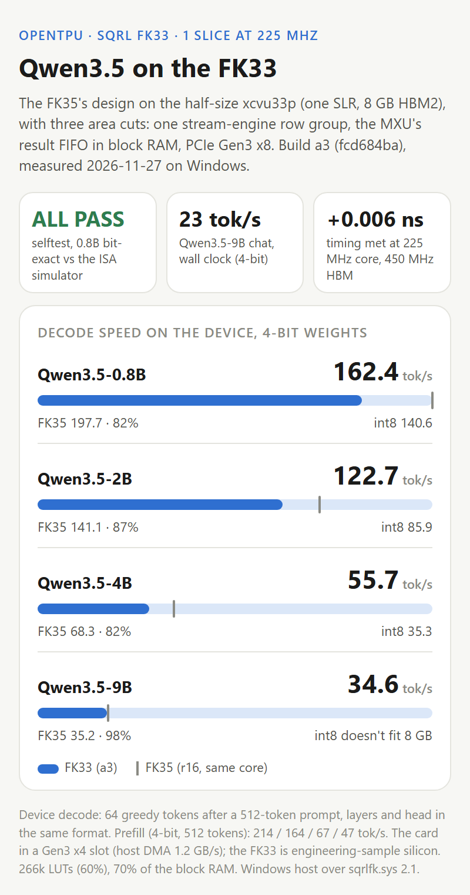
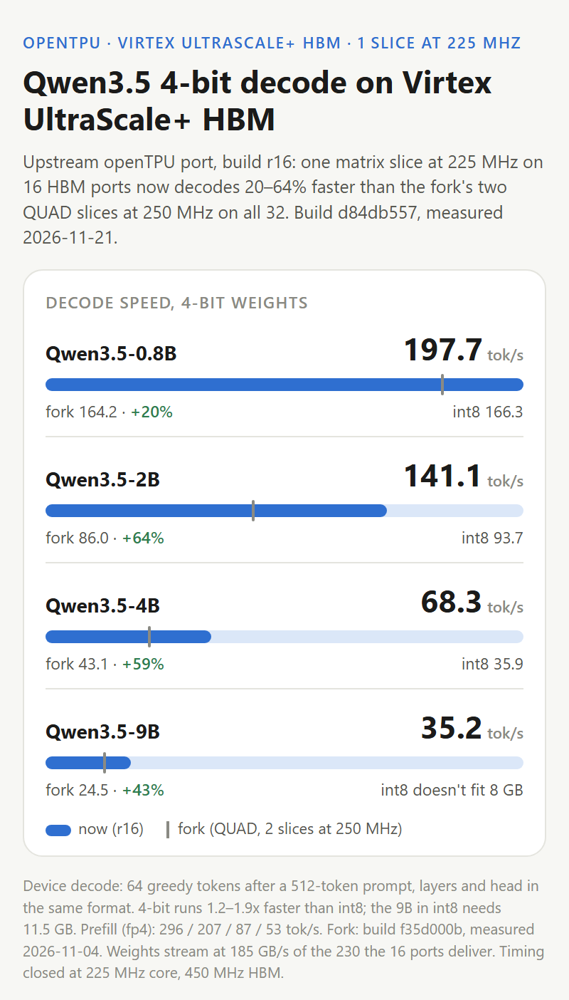

# Chat with AI models on a SQRL Forest Kitten card (FK33 / FK35)

This guide takes you from a SQRL Forest Kitten card in your PC to chatting with a language model running on it, on
Windows or Linux, without building anything. Every step is one ready-made script; you double-click it (Windows) or
type one line (Linux). All paths below are inside this repository (the openTPU folder you downloaded).

| FK33 | FK35 |
|---|---|
|  |  |

What runs on the card: Qwen3.5 language models from 0.8B to 9B parameters. In a chat the 9B model writes about 23
tokens (word pieces) per second on the FK33; the card itself runs it at 35 on either card, the small models at well
over 100. The image the card runs ("the
bitstream") is ready-made: [prebuilt/sqrl-fk33/a3](../prebuilt/sqrl-fk33/a3/README.md) for the FK33,
[prebuilt/sqrl-fk35/r16](../prebuilt/sqrl-fk35/r16/README.md) for the FK35.

## What you need

- **The card** in a **physical x16 PCIe slot** (the long one; the card does not fit a shorter slot), with a fan
  blowing over it. The slot may wire fewer lanes: the card also works in an x16 slot that runs at x8 or x4 (many
  boards' second or third long slot), only its transfers to and from the PC are slower; the tests here ran in an x4
  one. The models themselves run at the same speed.
- **A micro-USB cable** from the card's micro-USB port to a USB port of the same PC (or another PC). The card has its
  programming interface (JTAG) built in behind that port; no separate programmer is needed. It is used once, in
  step 1, to put the image into the card's memory; after that the card loads it by itself at every power-on, and the
  cable can come off.
- **Vivado, to load the image (step 1 only)**: any edition and version, for example the free **Vivado Lab Edition**
  (from AMD's website: Downloads, "Vivado Lab Solutions"; it needs a free AMD account). Install it into the default
  folder with the cable drivers ticked. A Vivado you already have works too; the scripts find it in C:\Xilinx or
  C:\AMDDesignTools (Windows), /tools/Xilinx or /opt/Xilinx (Linux). (Only building the image yourself needs
  Vivado 2019.2.)
- **Python 3.10 or later** (3.12 or 3.13 recommended). Windows: from [python.org](https://www.python.org/downloads/),
  tick "Add python.exe to PATH" in the installer. Linux: your distribution's `python3`.
- **About 30 GB of free disk** and an internet connection (the models download in step 3; 9B alone is 18 GB).
- **Download this repository**: on its GitHub page, "Code", "Download ZIP", and unpack it, for example to
  `C:\openTPU` (Windows) or `~/openTPU` (Linux). Or `git clone` it.

## Windows

The scripts are in `boards\sqrl-fk\windows\`. Open that folder in File Explorer and double-click them in order. Those
that talk to the card ask "Do you want to allow this app to make changes?": answer Yes (the card's driver only lets
administrators use it). Each one waits for a key press at the end, so you can read what it said.

| Step | Double-click | What it does | How long |
|---|---|---|---|
| 1 | `boards\sqrl-fk\windows\1-flash-fk33.cmd` (FK33) or `boards\sqrl-fk\windows\1-flash-fk35.cmd` (FK35) | writes the openTPU image into the card's flash memory over the micro-USB cable, then brings the card back in Windows | about 10 minutes; **once** |
| | | then **shut the PC down and start it again** (a full shutdown, not "Restart") | |
| 2 | `boards\sqrl-fk\windows\2-install-driver.cmd` | installs the card's driver (`prebuilt\sqrlfk-windows\2.1`). The first time it turns on Windows' "test signing" mode, which this driver needs, and asks you to restart and run it again | a minute; **once** |
| 3 | `boards\sqrl-fk\windows\3-setup.cmd` | sets up Python for the models and downloads two: Qwen3.5-0.8B (for the test) and Qwen3.5-9B | 15-60 minutes (the downloads); **once** |
| 4 | `boards\sqrl-fk\windows\4-selftest.cmd` | checks the card: every line should say PASS, the last one **ALL PASS** | 2 minutes |
| 5 | `boards\sqrl-fk\windows\5-chat.cmd` | **the chat**, with the largest model you downloaded | starts in seconds (the first time a few minutes) |

**Step 1 in more detail.** The script finds the card's USB programming port by itself and leaves any other
programming cables on the PC alone. It prints `card back: ... PCIe Gen3 x4` (FK35: Gen4) when it is done. With
several cards connected by USB it stops and asks you to choose one: run it from a terminal with
`-Target <name>` (part of the name it lists, e.g. `1-flash-fk33.cmd -Target 153300001975A`).

**Step 2 in more detail.** Windows only loads drivers signed by Microsoft, unless "test signing" is on; this driver is
signed with a test certificate. Test signing requires **Secure Boot off**: enter the PC's firmware setup while it
starts (usually F2 or Del), find Secure Boot (often under Boot or Security), set it to Disabled, save and exit. Then run
`2-install-driver.cmd`: it turns test signing on (answer Y), you restart, the words "Test Mode" appear in a corner of
the desktop, you run it again and it installs the driver; Windows asks whether to install software from an unverified
publisher: choose Install. In Device Manager the card then shows as "SQRL Forest Kitten FK33/FK35" under System
devices.

**Step 5, chatting.** Type a question and press Enter. `/help` lists the chat's commands; `/quit` or Ctrl+C ends it.
The first chat with a model takes a few minutes to prepare it and its first answers come slowly while it finishes in
the background; from then on it starts in seconds. The script runs the largest model you downloaded with 4-bit
weights and the longest conversation memory the card holds; other models and settings: see
[Chat options](#chat-options) below (for example `5-chat.cmd Qwen3.5-4B --think`). To give options, open the terminal
as administrator (right-click Terminal or Command Prompt, "Run as administrator"), go to the folder
(`cd C:\openTPU\boards\sqrl-fk\windows`) and type the script's name with them; double-clicking takes none.

More scripts in the same folder:

| Double-click | What it does |
|---|---|
| `boards\sqrl-fk\windows\serve.cmd` | offers the model to other programs as an OpenAI-compatible server at `http://127.0.0.1:8000/v1` (chat apps that accept a custom server address): [the server on port 8000](#the-server-on-port-8000) |
| `boards\sqrl-fk\windows\monitor.cmd` | shows the card's state every second: temperature, memory, how busy it is, which program uses it |

Behind them: `boards\sqrl-fk\host\otpu-fk.cmd` runs any openTPU tool on the card (`otpu-fk.cmd -m opentpu.host.selftest`,
`otpu-fk.cmd chat Qwen3.5-9B --wformat fp4`, ...); `boards\sqrl-fk\host\setup_win_python.ps1` makes the Python environment
(`build\venv-win`); `prebuilt\sqrl-fk33\a3\fk33_flash.ps1` and `prebuilt\sqrl-fk35\r16\fk35_flash.ps1` flash the cards
([sqrl-fk.md "Windows host"](sqrl-fk.md#windows-host)).

## Linux

The scripts are in `boards/sqrl-fk/linux/`. Open a terminal in the repository's folder (`cd ~/openTPU`) and type
each line. Install the tools the driver build needs first (Debian / Ubuntu; other distributions have the same
packages under similar names):

```
sudo apt install python3-venv git build-essential patch dkms linux-headers-$(uname -r)
```

and Vivado's USB cable drivers (once, as root, from Vivado's folder, e.g. for Lab Edition 2019.2:
`sudo /tools/Xilinx/Vivado_Lab/2019.2/data/xicom/cable_drivers/lin64/install_script/install_drivers/install_drivers`).

| Step | Type | What it does | How long |
|---|---|---|---|
| 1 | `bash boards/sqrl-fk/linux/1-flash-fk33.sh` (FK33) or `bash boards/sqrl-fk/linux/1-flash-fk35.sh` (FK35) | writes the openTPU image into the card's flash memory over the micro-USB cable | about 10 minutes; **once** |
| | | then **power the PC off and on** | |
| 2 | `bash boards/sqrl-fk/linux/2-setup.sh` | sets up Python (`build/venv-linux`), installs the card's driver (Xilinx's XDMA driver, asks for your password) and downloads Qwen3.5-0.8B and Qwen3.5-9B | 15-60 minutes; **once** |
| 3 | `bash boards/sqrl-fk/linux/3-selftest.sh` | checks the card: every line PASS, the last one **ALL PASS** | 2 minutes |
| 4 | `bash boards/sqrl-fk/linux/4-chat.sh` | **the chat**, with the largest model you downloaded | starts in seconds (the first time a few minutes) |

More: `bash boards/sqrl-fk/linux/serve.sh` (the OpenAI-compatible server at `http://127.0.0.1:8000/v1`),
`bash boards/sqrl-fk/linux/monitor.sh` (the card's state), `bash boards/sqrl-fk/linux/4-chat.sh Qwen3.5-4B` (another
model; download it first with `bash boards/sqrl-fk/linux/2-setup.sh Qwen3.5-4B`). `1-flash-fk33.sh list` lists the
USB programming ports Vivado sees; `1-flash-fk33.sh <name>` picks one. Vivado elsewhere than `/tools/Xilinx` or `/opt/Xilinx`:
`VIVADO=/path/to/vivado_lab bash boards/sqrl-fk/linux/1-flash-fk33.sh`. Behind them:
`boards/sqrl-fk/linux/common.sh`, `boards/sqrl-fk/scripts/fk_flash.tcl` and the openTPU commands (`otpu-chat`,
`otpu-serve`, `otpu-selftest`, `otpu-smi`: [host.md](host.md)).

The Linux scripts use openTPU's own Linux driver and host, as its other boards do; they have not yet been run with an
FK card (the cards were tested on Windows).

## Chat options

The chat scripts, `boards\sqrl-fk\windows\5-chat.cmd` (Windows) and `boards/sqrl-fk/linux/4-chat.sh` (Linux), take a
model name first, then any of these options:

```
5-chat.cmd Qwen3.5-4B --think                                   (Windows, in an administrator terminal)
bash boards/sqrl-fk/linux/4-chat.sh Qwen3.5-9B --plain          (Linux)
5-chat.cmd Qwen3.5-2B --prompt "What is an FPGA?"               (one question, one answer, then exit)
```

**Everyday**

| Option | What it does | The scripts' default |
|---|---|---|
| *model name* (first) | the model: a folder in `models\` (`Qwen3.5-0.8B`, `Qwen3.5-2B`, `Qwen3.5-4B`, `Qwen3.5-9B`; download more with `3-setup.cmd` / `2-setup.sh`), or the full path of a model folder | the largest one downloaded |
| `--plain` | a simple line-by-line chat in the terminal instead of the full-screen window (also for terminals the window does not suit) | the full-screen window |
| `--prompt "TEXT"` | ask one question, print the answer and exit | a conversation |
| `--think` | thinking mode: the model reasons before it answers (slower; often better at maths and logic). `/think on` / `/think off` switch it inside the chat | off |
| `--max-new N` | the longest reply, in tokens (about 3/4 of a word each); `/continue` goes on with a reply that was cut | 8192 |
| `--cap N` | the conversation's memory (its context), in tokens: how much of the chat the model sees. Less memory leaves room on the card | the most the card holds: 171,520 for the 9B on the FK33, the full 262,144 for the smaller models |
| `--wformat F` | the weights' format. `fp4`: 4-bit, the fastest and smallest; `int8`: 8-bit, a little more accurate, slower and twice the size (the 9B does not fit in it); `nvfp4`, `int4`: other 4-bit formats; `mix`: the model's own recommended mix of 8- and 4-bit (Qwen3.5-4B has one); `auto`: `mix` where the model has one, else `int8` | `fp4` |
| `--head-format F` | the format of the model's last layer alone (its output, the largest single layer): `int8`, `fp4`, `int4`, `nvfp4` | as `--wformat` |

**How the model picks its words** (sampling; the defaults are the model's own: for Qwen3.5 temperature 0.7, top-k 20,
top-p 0.8)

| Option | What it does |
|---|---|
| `--temperature T` | how adventurous the wording is: lower is more predictable, higher more varied (0.7 is Qwen3.5's) |
| `--top-k K` | choose each word among the K most likely only |
| `--top-p P` | choose among the most likely words that together make up P (0 to 1) of the probability |
| `--repetition-penalty R` | above 1 discourages repeating itself |
| `--greedy` | always the most likely word: the same question gives the same answer |
| `--seed N` | the same sequence of random choices on every run (a repeatable answer with sampling on) |

**Advanced**

| Option | What it does | Default |
|---|---|---|
| `--dev D` | which card, when the PC has several: Windows `sqrlfk0`, `sqrlfk1`, ...; Linux `/dev/xdma0`, ... | the card present |
| `--mtp` | Qwen3.5's built-in draft model guesses words ahead, which the card checks: the same replies 1.3-1.6x faster (openTPU's measurement on its other cards; not yet tried on the FK cards) | off |
| `--raw` | a base model without a chat template: the text is continued rather than answered | off |
| `--clock-mhz F` | the clock used to turn the card's cycles into the tokens/s shown (the card reports its own) | the card's |
| `--no-prog-cache`, `--no-prompt-runs`, `--per-position` | compile the card's programs afresh instead of reusing them (troubleshooting; slow) | off |
| `--image PATH`, `--max-slices N` | a picture with the first message, for a model that sees images (MiniCPM-V); not for the Qwen3.5 text models | none |
| `--pool`, `--experts`, `--policy`, `--layer-major`, `--slots`, `--embed-table`, `--mtp-from`, `--poll-idle` | for mixture-of-experts models bigger than the card's memory, which stream their experts from the PC ([offload.md](offload.md)); not for the Qwen3.5 models above | |

`--model`, `--backend board` and, unless given, `--wformat fp4`, `--cap` and `--max-new` are set by the scripts
(`boards/sqrl-fk/host/otpu_fk_run.py`); the full list with the developers' notes: `otpu-chat --help` ([host.md](host.md)
section 6).

Inside the chat (the full-screen window; `--plain` knows only `/continue`, `/reset` and `/image`, and an empty line
or Ctrl+Z / Ctrl+D ends it):

| Type | What it does |
|---|---|
| `/help` | the commands and keys |
| `/continue` | go on with a reply that stopped at its length limit (`--max-new`) |
| `/reset` | forget the conversation and start a new one |
| `/stats` | the card's memory, the session's totals and the sampling settings |
| `/think on`, `/think off` | thinking mode on or off |
| `/quit` (or Ctrl+C) | leave |
| Esc | stop the reply being written |
| Ctrl+S | show or hide the side panel (speed, memory, settings) |
| `/image PATH` | (`--plain`, image models only) a picture with the next message |

## The server on port 8000

`boards\sqrl-fk\windows\serve.cmd` (Windows) or `bash boards/sqrl-fk/linux/serve.sh` (Linux) runs the model as a
server that speaks OpenAI's API, so programs written for ChatGPT's API, and chat apps with a "custom OpenAI-compatible
server" setting, can use the card instead:

| Setting in the app | Value |
|---|---|
| server / base URL | `http://127.0.0.1:8000/v1` (from the same PC) |
| API key | anything, unless the server was started with `--api-key` |
| model | the model's folder name, e.g. `Qwen3.5-9B` (`http://127.0.0.1:8000/v1/models` lists it) |

Open `http://127.0.0.1:8000/` in a browser for its dashboard (requests, speed, the card). It answers
`/v1/chat/completions` and `/v1/completions`, streamed or not. It runs until its window is closed (Ctrl+C).

Options, after the model name as for the chat (`serve.cmd Qwen3.5-4B --port 8001`):

| Option | What it does | Default |
|---|---|---|
| *model name* (first) | as for the chat | the largest one downloaded |
| `--port N` | the port: the address becomes `http://127.0.0.1:N/v1` (for example when 8000 is taken) | `8000` |
| `--host 0.0.0.0` | accept other PCs on the network, at `http://<this PC's address>:8000/v1` (Windows asks once whether to let it through the firewall); set `--api-key` with it | `127.0.0.1`: this PC only |
| `--api-key KEY` | require this key from every client (`Authorization: Bearer KEY`; also the environment variable `OTPU_API_KEY`) | none |
| `--served-model-name NAME` | the model's name in the API | the folder's name |
| `--think` | thinking mode by default (a request can switch it with `chat_template_kwargs: {"enable_thinking": ...}`) | off |
| `--reasoning-parser qwen3` | return the model's thinking separately (`reasoning_content`) instead of inside the answer | off |
| `--wformat F`, `--cap N`, `--dev D` | as for the chat | `fp4`, the most the card holds, the card present |

The full list (request queues, saved conversations, monitoring): `otpu-serve --help` and [serve.md](serve.md).
A test from a terminal (Linux, or Windows' `curl.exe`):

```
curl http://127.0.0.1:8000/v1/chat/completions -H "Content-Type: application/json" -d "{\"model\": \"Qwen3.5-9B\", \"messages\": [{\"role\": \"user\", \"content\": \"Hello\"}]}"
```

## Every day

Nothing to repeat: the card loads openTPU from its flash at every power-on, the driver stays installed. Start the
chat (step 5 on Windows, 4 on Linux). Avoid sleep and hibernation while you use the card: they switch the slot off
(it loads again at the next full power-on).

## If something goes wrong

| What you see | What to do |
|---|---|
| step 1: `Vivado not found` | install Vivado Lab Edition (any version) into its default folder, or tell the script where Vivado is: `-Vivado <path to vivado.bat>` (Windows), `VIVADO=<path>` (Linux) |
| step 1: `... targets: '' (want exactly one ...)` | Vivado does not see the card: check the micro-USB cable at both ends (a charge-only cable carries no data: try another), that the PC is on, and that Vivado's cable drivers are installed |
| step 1 on an FK33: warning "Incorrect bitstream assigned to device" | harmless: the FK33s are engineering-sample chips, the script allows that |
| step 2: "Windows refused" / test signing does not turn on | Secure Boot is still on: switch it off in the firmware setup |
| step 4 or 5: "cannot open the SQRL FK board" | the driver is not installed (step 2), or the window was not allowed administrator rights |
| step 4: `registers read 0xffffffff` or `link` FAIL | the PC has not seen the card since it was flashed: shut the PC down fully and start it again |
| step 4: a FAIL elsewhere | run it once more; if it fails again, keep the window's text and ask for help with it |
| a slow link (the flash script's last line says Gen1, or Gen3 on an FK35) | shut down fully and start again rather than "Restart" |
| the first chat answers very slowly | normal for a model's first minutes (it is still preparing); later chats are fast |

For developers: the design, its memory map, clocks and how to build it yourself are in [sqrl-fk.md](sqrl-fk.md);
the Linux host's details in [host.md](host.md).
