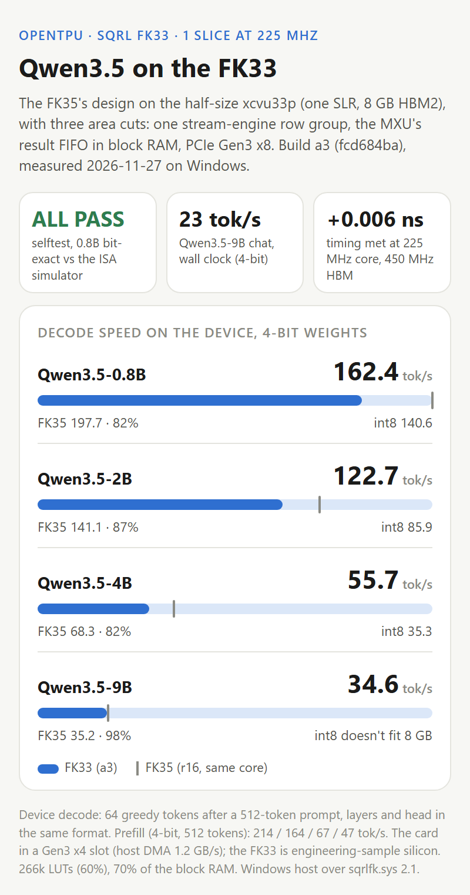

# SQRL FK33, board sqrl-fk build a3 (core 225 MHz, two HBM ports a channel, PCIe Gen3 x8)

The FK33 (Virtex UltraScale+ HBM xcvu33p-fsvh2104-2-e, one SLR, 8 GB HBM2) with one WG slice (MCOLS 8, WG 8) on eight
1 GiB channels, each an `otpu_hbm_ch` bridge on two HBM AXI ports, and XDMA at PCIe Gen3 x8: target
`targets/sqrl-fk33.toml`, architecture hash 0x2DE9DD09 (the FK35's), docs/sqrl-fk.md. It is the FK35's r16 design with
three cuts for the half-size FPGA: SE_R 1, the MXU's result FIFO in block RAM, PCIe Gen3 x8 instead of Gen4.
Built 2026-11-27 with Vivado 2019.2, flashed and tested the same day.

**From the card to a chat, step by step (no programming): [docs/sqrl-fk-quickstart.md](../../../docs/sqrl-fk-quickstart.md).**
In short, one script per step:

| Step | Windows (double-click) | Linux (`bash ...` in the repository) |
|---|---|---|
| 1. flash the card (once) | `boards\sqrl-fk\windows\1-flash-fk33.cmd` | `boards/sqrl-fk/linux/1-flash-fk33.sh` |
| 2. driver (once) | `boards\sqrl-fk\windows\2-install-driver.cmd` | (in step 3) |
| 3. Python and models (once) | `boards\sqrl-fk\windows\3-setup.cmd` | `boards/sqrl-fk/linux/2-setup.sh` |
| 4. check the card | `boards\sqrl-fk\windows\4-selftest.cmd` | `boards/sqrl-fk/linux/3-selftest.sh` |
| 5. chat | `boards\sqrl-fk\windows\5-chat.cmd` | `boards/sqrl-fk/linux/4-chat.sh` |
| server for other apps | `boards\sqrl-fk\windows\serve.cmd` | `boards/sqrl-fk/linux/serve.sh` |
| the card's state | `boards\sqrl-fk\windows\monitor.cmd` | `boards/sqrl-fk/linux/monitor.sh` |

The card needs a physical x16 slot; it runs on as few lanes as the slot wires (x8, x4; tested in an x4-wired slot).

## Build

| | |
|---|---|
| Sources | this branch's board sqrl-fk at fcd684ba (BUILD_ID 0xFCD684BA) with the FK33 target's cuts |
| Command | `TARGET=sqrl-fk33 boards/sqrl-fk/run_vivado.sh` (make_defines.py: core 225 MHz, uclk 450, TMEM_RQL 255, NAT_XD 128, SE_R 1, MXU_RF_STYLE block, COLL_GATHER 0, RLY 00000000, HNP 2, PCIE_GEN 3), placer directive `AltSpreadLogic_high` (`OTPU_PLACE_DIRECTIVE`), floorplan hard |
| Clocks | core_clk 225 MHz, core_clk2x 450 (pumped TMEM), uclk 450 (HBM AXI), XDMA axi_aclk 250, clk100 |
| Timing | **met**: WNS +0.006 ns, WHS +0.009 ns. core_clk +0.048, core_clk2x +0.044, uclk +0.006, xdma_aclk +0.022, pipe_clk +0.103, TXOUTCLK +0.190 ns (`reports/SUMMARY.txt`, `reports/timing_summary_tables.rpt`) |
| Utilization | 266k LUTs (60.4%), 319k FFs (36.3%), CLBs 96.2%, 472.5 RAMB36 (70.3%), 156 URAM (48.8%) (`reports/util*.rpt`) |

## Files

| File | Bytes | SHA-256 |
|---|--:|---|
| `otpu.bit` | 24,405,598 | `8f9796814c159cbdca3f9b1aee26f66c23a949850e1c99c7473b10f3fb0eb174` |
| `otpu_primary.mcs` | 34,323,514 | `7ca17d0fda56b0570c3a0d8cab9c252bddb44639069706baf6016a40d046ca08` |
| `otpu_primary.prm` | 381 | `8f090c2371b786f27b5cb1eb3f8343b3b2884c416400e4d2b22fdf23d7e359cd` |
| `otpu_secondary.mcs` | 34,323,514 | `bcd27dc4b4a54120a85982259aa10ad0ef8d05639243734dff7da3f4d547b0d0` |
| `otpu_secondary.prm` | 381 | `8f090c2371b786f27b5cb1eb3f8343b3b2884c416400e4d2b22fdf23d7e359cd` |
| `otpu.ltx` | 1,040 | `1bfa8aa092987ad4bcc2634442a92bf2094206bd7d8442d86bb2d2d0bdf9a7f3` |
| `fk33_flash.ps1` | | the Windows flash and bring-up script below |
| `fk33_qwen35.png` | | the results above |
| `reports/` | | SUMMARY, utilization (flat and per SLR), congestion, clock interaction, power, the timing summary's tables |

- **Flash:** `otpu_primary.mcs` and `otpu_secondary.mcs`, each with its `.prm`: the board's two MT25QU256 in dual QSPI
  (SPIx8). One plain bitstream.
- **JTAG (volatile):** `otpu.bit`, with `otpu.ltx` for the HBM IP's debug core.

## Use

The step scripts above wrap these:

1. Flash it. Windows, as administrator in this folder: `.\fk33_flash.ps1` (any Vivado or Vivado Lab Edition
   in `C:\Xilinx`, or `-Vivado <vivado.bat>`): it disables the card, programs both
   flashes over the one JTAG target that holds a single xcvu33p (`-Target` / `-Dna` to pin it), boots from flash,
   restarts the card's root port and rescans, booting again over JTAG if Windows misses the card (any Vivado's
   hardware manager, the free Lab Edition too, `-Vivado`; about 10 minutes). Linux: `boards/sqrl-fk/scripts/fk_flash.tcl` with this folder and
   `xcvu33p` (docs/sqrl-fk-quickstart.md). The FK33s seen so far are engineering samples (JTAG IDCODE revision 0):
   both scripts turn Vivado's bitstream version check off, so it programs them (with an "Incorrect bitstream" warning).
2. The host: target `sqrl-fk33` (`OTPU_TARGET`; `boards/sqrl-fk/host/otpu_fk_run.py` reads it from the card when
   unset); Windows `boards\sqrl-fk\host\otpu-fk.cmd` over sqrlfk.sys
   (prebuilt/sqrlfk-windows/2.1), Linux `otpu-setup` (XDMA, 1e24:1533). `otpu-selftest` reports
   `sqrl-fk33 (S=1, 8 channels x 1024 MiB in 128-byte beats), core 225 MHz, HBM2-1800, build fcd684ba`.

## Tested on the board (2026-11-27)

Test PC: Windows 10, the card in an x4 slot behind root port 0:1B.4 (Intel 7AC4), PCIe Gen3 x4; sqrlfk.sys 2.1,
`boards\sqrl-fk\host\otpu-fk.cmd`.

- `otpu-selftest --model qwen35`: ALL PASS, all 8 channels (host -> card 1.23 GB/s, card -> host 1.06 GB/s at Gen3
  x4); its model stage on Qwen3.5-0.8B ALL PASS in int8 and fp4, bit for bit with the ISA simulator ("The capital of
  France is Paris."); one-token runs 1.68 / 1.46 Mcycles.
- `tools/qual/perf.py`, tokens/s on the device (the FK35 r16's in brackets):

  | Qwen3.5 | decode fp4 | decode int8 | prefill fp4 (512 tokens) | prefill int8 |
  |---|---:|---:|---:|---:|
  | 0.8B | 162.4 (197.7) | 140.6 (166.3) | 214 (296) | 198 |
  | 2B | 122.7 (141.1) | 85.9 (93.7) | 164 (207) | 122 |
  | 4B | 55.7 (68.3) | 35.3 (35.9) | 67 (87) | 49 |
  | 9B | 34.6 (35.2) | (does not fit 8 GB) | 46.9 (52.6) | |

  9B decodes about as fast as on the FK35; the smaller models are 10-20% slower in fp4 (the FK33's area cuts).
