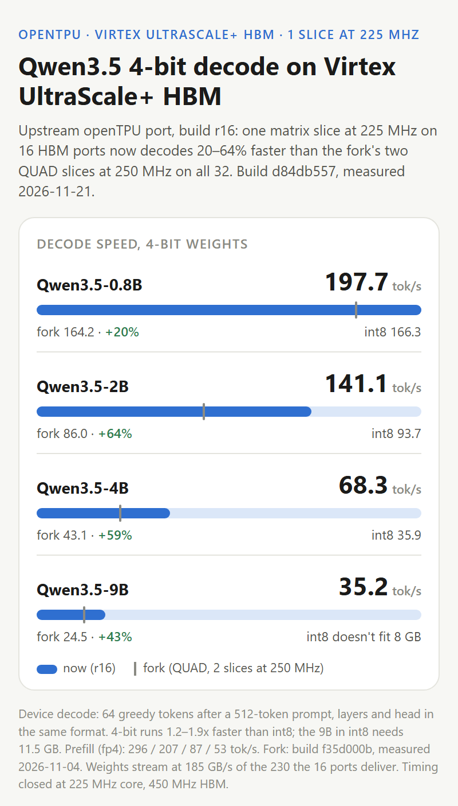

# SQRL FK35, board sqrl-fk build r16 (core 225 MHz, two HBM ports a channel, PCIe Gen4 x8)

The FK35 (Virtex UltraScale+ HBM xcvu35p-fsvh2104-2-e, 8 GB HBM2) with one WG slice (MCOLS 8, WG 8) on eight 1 GiB
channels, each an `otpu_hbm_ch` bridge on two HBM AXI ports, and XDMA at PCIe Gen4 x8: target `targets/sqrl-fk35.toml`,
architecture hash 0x2DE9DD09, docs/sqrl-fk.md. Built 2026-11-21 with Vivado 2019.2, flashed and tested the same day.

**From the card to a chat, step by step (no programming): [docs/sqrl-fk-quickstart.md](../../../docs/sqrl-fk-quickstart.md).**
In short, one script per step:

| Step | Windows (double-click) | Linux (`bash ...` in the repository) |
|---|---|---|
| 1. flash the card (once) | `boards\sqrl-fk\windows\1-flash-fk35.cmd` | `boards/sqrl-fk/linux/1-flash-fk35.sh` |
| 2. driver (once) | `boards\sqrl-fk\windows\2-install-driver.cmd` | (in step 3) |
| 3. Python and models (once) | `boards\sqrl-fk\windows\3-setup.cmd` | `boards/sqrl-fk/linux/2-setup.sh` |
| 4. check the card | `boards\sqrl-fk\windows\4-selftest.cmd` | `boards/sqrl-fk/linux/3-selftest.sh` |
| 5. chat | `boards\sqrl-fk\windows\5-chat.cmd` | `boards/sqrl-fk/linux/4-chat.sh` |
| server for other apps | `boards\sqrl-fk\windows\serve.cmd` | `boards/sqrl-fk/linux/serve.sh` |
| the card's state | `boards\sqrl-fk\windows\monitor.cmd` | `boards/sqrl-fk/linux/monitor.sh` |

The card needs a physical x16 slot; it runs on as few lanes as the slot wires (x8, x4; tested in an x4-wired slot).

## Build

| | |
|---|---|
| Sources | this branch's board sqrl-fk on upstream main d84db557 (BUILD_ID 0xD84DB557) |
| Command | `TARGET=sqrl-fk35 boards/sqrl-fk/run_vivado.sh` (make_defines.py: core 225 MHz, uclk 450, TMEM_RQL 255, NAT_XD 128, COLL_GATHER 0, RLY 55555555, HNP 2), placer directive `AltSpreadLogic_high` (`OTPU_PLACE_DIRECTIVE`), floorplan hard |
| Clocks | core_clk 225 MHz, core_clk2x 450 (pumped TMEM), uclk 450 (HBM AXI), XDMA axi_aclk 250, clk100 |
| Timing | **met**: WNS +0.007 ns, WHS +0.003 ns. core_clk +0.008, core_clk2x +0.015, uclk +0.011, xdma_aclk +0.021, pipe_clk +0.024, TXOUTCLK +0.007 ns (`reports/SUMMARY.txt`, `reports/timing_summary_tables.rpt`) |
| Utilization | 328k LUTs (37.6%), 398k FFs (22.8%), 473.5 RAMB36 (35.2%), 156 URAM (24.4%), 1,502 DSPs (25.2%) (`reports/util*.rpt`) |

## Files

| File | Bytes | SHA-256 |
|---|--:|---|
| `otpu.bit` | 44,649,250 | `02e45ef5af2a9e7523539ebfc1ba70c61e0a8d592bf2791308cbedc6d3d88da5` |
| `otpu_primary.mcs` | 62,793,766 | `7195e1cea4b3bb20fd3d4e7b9bd64646e0544d243b9e269cb0abe671f745df2c` |
| `otpu_primary.prm` | 386 | `bf5df126881f5f1b31b10c4a8ad895755744afa55e0104b237f6388cff736952` |
| `otpu_secondary.mcs` | 62,793,766 | `265240ae403c35c5e39defb7dbae79a928ca8488f01170a5079c824f54db4b44` |
| `otpu_secondary.prm` | 386 | `bf5df126881f5f1b31b10c4a8ad895755744afa55e0104b237f6388cff736952` |
| `otpu.ltx` | 1,040 | `1bfa8aa092987ad4bcc2634442a92bf2094206bd7d8442d86bb2d2d0bdf9a7f3` |
| `fk35_flash.ps1` | | the flash and bring-up script below |
| `reports/` | | SUMMARY, utilization (flat and per SLR), congestion, clock interaction, power, the timing summary's tables |

- **Flash:** `otpu_primary.mcs` and `otpu_secondary.mcs`, each with its `.prm`: the board's two MT25QU256 in dual QSPI
  (SPIx8). One plain bitstream.
- **JTAG (volatile):** `otpu.bit`, with `otpu.ltx` for the HBM IP's debug core.

## Use

1. As administrator: `.\fk35_flash.ps1` (in this folder). It disables the card, programs both flashes over the one
   JTAG target that holds a single xcvu35p (`-Target` / `-Dna` to pin it), boots from flash, restarts the card's root
   port (the new design's BARs) and rescans, booting again over JTAG if Windows misses the card. any Vivado's
   hardware manager, the free Lab Edition too (`-Vivado`); about 17 minutes.
2. Restart the PC fully (not a warm reboot, not sleep) for Gen4: the test PC's slot trained Gen3 x4 after every hot
   retrain and Gen4 x4 only after a full restart.
3. The host: target `sqrl-fk35`; on Linux `opentpu/host/setup_pcie.sh` binds XDMA (1e24:1533), on Windows
   `boards/sqrl-fk/host/otpu-fk.cmd` runs the tools through sqrlfk.sys (docs/sqrl-fk.md "Windows host"). `otpu-selftest`
   reports `sqrl-fk35 ... core 225 MHz, HBM2-1800, build d84db557`.

## Tested on the board (2026-11-21)

Test PC: Windows, the card in an x4 slot behind root port 0:1B.4 (Intel 7AC4), PCIe Gen4 x4.

- `otpu-selftest`: ALL PASS, all 8 channels (host -> card ~1.6 GB/s, card -> host ~2.0 GB/s through the host's
  two-port channel layout).
- Its model stage on Qwen3.5-0.8B: ALL PASS in int8 and fp4, bit for bit with the ISA simulator ("The capital of
  France is Paris."); one-token runs 1.42 / 1.19 Mcycles.
- `tools/board_perf.py wstream` (port W's weight stream): fp4 184.7 GB/s (1 GiB), int8 197.3 GB/s.
- `tools/qual/perf.py`, tokens/s on the device:

  | Qwen3.5 | decode fp4 | decode int8 | prefill fp4 (512 tokens) |
  |---|---:|---:|---:|
  | 0.8B | 197.7 | 166.3 | 296 |
  | 2B | 141.1 | 93.7 | 207 |
  | 4B | 68.3 | 35.9 | 87 |
  | 9B | 35.2 (33.1 wall) | (does not fit 8 GB) | 52.6 |
